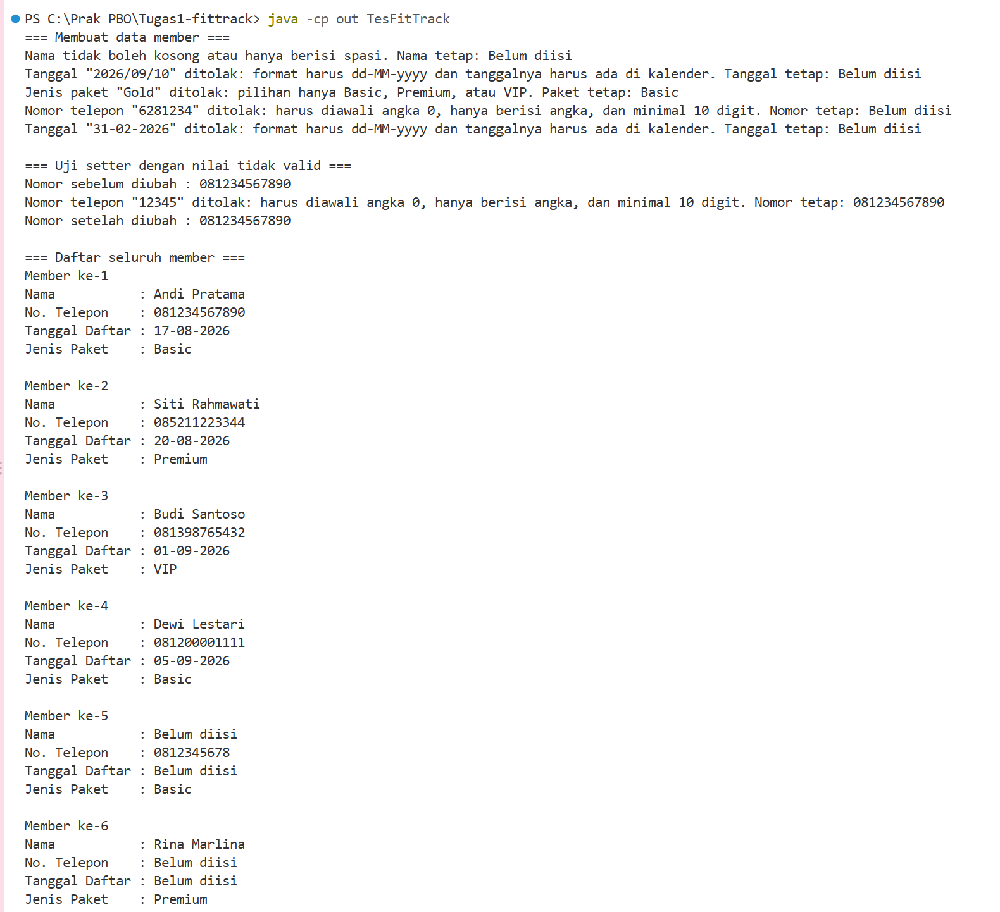

# Tugas 1: Sistem Keanggotaan Gym FitTrack (Remedial UTS Praktikum PBO)

Nama: Najla Putri Syahnuza
NPM: 250810701100115
Kelas Praktikum: (isi kelas, contoh: A)
Mata Kuliah: Praktikum Pemrograman Berorientasi Objek

## Deskripsi
Program ini untuk mencatat data member gym FitTrack. Setiap data yang dimasukkan dicek dulu, jadi kalau ada data yang salah (misalnya nomor telepon ada hurufnya atau paket yang tidak tersedia), data itu ditolak tanpa membuat program berhenti.

## Fitur
- Menambah member dengan nama, no telepon, tanggal daftar, dan jenis paket
- Menambah member tanpa pilih paket, otomatis jadi Basic
- Menolak nama kosong, no telepon yang salah format, tanggal yang bukan dd-MM-yyyy atau tidak ada di kalender (misalnya 31-02-2026), dan paket selain Basic/Premium/VIP
- Menampilkan alasan kalau data ditolak
- Menampilkan semua data member

## Konsep OOP
| Konsep | Dipakai di | Alasan |
|---|---|---|
| Enkapsulasi | atribut private, getter dan setter | supaya data cuma bisa diubah lewat setter yang ada validasinya |
| Overloading | 2 constructor Member | biar bisa buat member dengan atau tanpa paket |
| this(...) | constructor 3 parameter | memanggil constructor 4 parameter dengan paket Basic, jadi tidak ada kode dobel |
| Validasi di setter (DRY) | setNama, setNoTelepon, setTanggalDaftar, setJenisPaket | constructor mengisi data lewat setter, jadi aturan validasi hanya ditulis di satu tempat |
| Override | toString() | supaya yang dicetak data member, bukan Member@xxxx |
| Array + for | TesFitTrack | untuk menyimpan banyak member dan mencetaknya satu per satu |

## Struktur
```
Tugas1-fittrack/
  src/
    Member.java
    TesFitTrack.java
  screenshot/
    output.png
  .gitignore
  README.md
```

## Prasyarat
- JDK (isi versi, contoh: 21)
- IntelliJ IDEA (disarankan)

## Cara Menjalankan
IntelliJ: buka folder project, buka `src/TesFitTrack.java`, lalu klik Run di method main.

Command line (dari folder project):
```
javac -d out src/Member.java src/TesFitTrack.java
java -cp out TesFitTrack
```

## Output
Member 1-3 dibuat dengan data normal (paket Basic, Premium, VIP). Member 4 dibuat lewat constructor tanpa paket sehingga otomatis Basic. Member 5 dan 6 sengaja berisi data yang melanggar validasi, dan pesan penolakannya muncul di bagian atas output. Uji setter menunjukkan nomor lama tetap bertahan setelah `setNoTelepon("12345")`.



## Nilai Default
- nama, noTelepon, tanggalDaftar: "Belum diisi", supaya kelihatan datanya belum lengkap dan tidak muncul null waktu dicetak
- jenisPaket: Basic, karena itu paket paling dasar jadi member tidak dapat fasilitas yang belum dibayar

Nilai default ditulis langsung di atribut, jadi kalau setter menolak data di constructor, atributnya tetap berisi nilai ini.

## Batasan dan Pengembangan Lanjutan
- Tanggal sudah dicek apakah ada di kalender, tapi belum dicek apakah tanggalnya di masa depan
- Data member belum disimpan ke file, hilang setelah program selesai
- Data masih ditulis di kode, belum ada input dari pengguna